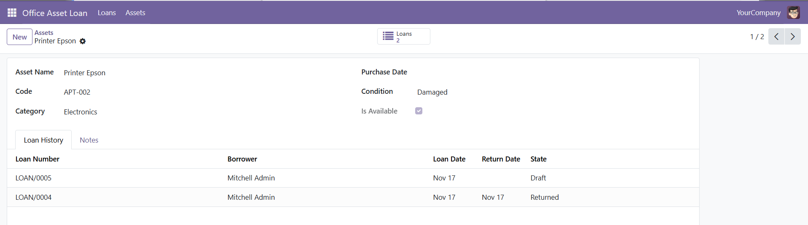
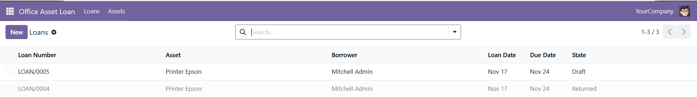
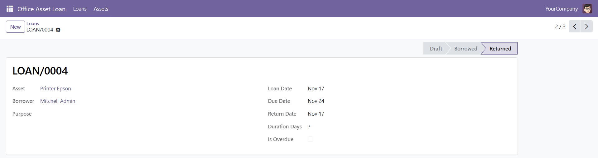

# Office Asset Loan (`office_asset_loan`)

> **Tugas Odoo Bootcamp Batch #10 (Basic): Custom Module Office Asset Loan**  
> **Odoo Community Edition 19.0**

## 1. Deskripsi Modul

Modul `office_asset_loan` merupakan modul kustom Odoo yang dirancang untuk membantu perusahaan dalam mengelola inventaris aset kantor dan proses peminjamannya secara terstruktur.

Modul ini dapat digunakan untuk mencatat berbagai aset kantor seperti laptop, proyektor, printer, kamera, dan perlengkapan kantor lainnya.

Dengan modul ini, pengguna dapat:

- Mengelola data inventaris dan informasi kondisi aset.
- Menggunakan kode unik untuk setiap aset.
- Memantau ketersediaan aset kantor.
- Mencatat transaksi peminjaman dan pengembalian.
- Mencegah peminjaman ganda pada aset yang sedang dipinjam.
- Mencegah peminjaman aset yang kondisinya rusak.
- Memantau tanggal jatuh tempo dan keterlambatan pengembalian.

## 2. Fitur Utama dan Aturan Bisnis

### A. Master Aset Kantor (`office.asset`)

Digunakan untuk mengelola data inventaris aset kantor.

Informasi yang dapat dicatat:

- Nama aset (*Asset Name*).
- Kode aset (*Asset Code*).
- Kategori: Electronics, Furniture, Vehicle, dan Other.
- Tanggal pembelian (*Purchase Date*).
- Kondisi aset: Good, Fair, dan Damaged.
- Catatan (*Notes*).
- Status aktif (*Active*).

**Fitur dan aturan bisnis:**

- **BR-1 – Unique Asset Code:** Kode setiap aset harus unik menggunakan database constraint.
- **Asset Availability:** Sistem menghitung ketersediaan aset berdasarkan transaksi peminjaman yang berstatus Borrowed.
- **Smart Button Loans:** Menampilkan jumlah transaksi peminjaman dan membuka daftar peminjaman berdasarkan aset terkait.
- **Loan History:** Menampilkan riwayat peminjaman pada halaman detail aset.
- **Available Filter:** Menyediakan filter untuk menampilkan aset yang tersedia.

### B. Pengelolaan Peminjaman (`office.asset.loan`)

Digunakan untuk mencatat dan mengelola transaksi peminjaman aset kantor.

Informasi yang dicatat:

- Nomor peminjaman (*Loan Number*).
- Aset yang dipinjam (*Asset*).
- Nama peminjam (*Borrower*).
- Tanggal peminjaman (*Loan Date*).
- Tanggal jatuh tempo (*Due Date*).
- Tanggal pengembalian (*Return Date*).
- Tujuan peminjaman (*Purpose*).
- Status peminjaman (*State*).

**Aturan bisnis:**

1. **BR-2 – Date Validation:** Tanggal jatuh tempo tidak boleh lebih awal dari tanggal peminjaman.
2. **BR-3 – Automatic Sequence:** Nomor peminjaman dibuat secara otomatis dengan format `LOAN/0001`, `LOAN/0002`, dan seterusnya.
3. **BR-4 – Borrow Validation:** Peminjaman hanya dapat dilakukan dari status Draft. Sistem menolak peminjaman jika aset sedang dipinjam atau kondisinya Damaged.
4. **BR-5 – Return Process:** Pengembalian hanya dapat dilakukan pada peminjaman berstatus Borrowed. Sistem otomatis mencatat tanggal pengembalian dan mengubah status menjadi Returned.
5. **BR-6 – Cancel Process:** Pembatalan hanya dapat dilakukan pada peminjaman berstatus Draft.
6. **BR-7 – Delete Protection:** Peminjaman berstatus Borrowed atau Returned tidak dapat dihapus.
7. **BR-8 – Automatic Due Date:** Ketika tanggal peminjaman diubah, sistem mengisi tanggal jatuh tempo menjadi tujuh hari setelah tanggal peminjaman apabila tanggal jatuh tempo kosong atau lebih awal.

### C. Perhitungan dan Pemantauan

- **Duration Days:** Menghitung selisih hari antara tanggal peminjaman dan tanggal jatuh tempo.
- **Overdue Detection:** Mendeteksi transaksi berstatus Borrowed yang telah melewati tanggal jatuh tempo.
- **Overdue Filter:** Menyediakan filter untuk menampilkan transaksi yang terlambat.
- **Visual Indicator:** Transaksi yang terlambat ditandai dengan warna merah pada daftar peminjaman.
- **Status Indicator:** Menampilkan status transaksi melalui status bar pada formulir peminjaman.

## 3. Struktur Folder Modul

Struktur direktori proyek:

```text
tugas-odoo-bootcamp/
│
├── office_asset_loan/
│   ├── data/
│   │   └── office_asset_loan_sequence.xml
│   │
│   ├── models/
│   │   ├── __init__.py
│   │   ├── office_asset_loan.py
│   │   └── office_asset.py
│   │
│   ├── screenshots/
│   │   ├── asset-form.png
│   │   ├── loan-form-borrowed.png
│   │   └── loan-list.png
│   │
│   ├── security/
│   │   └── ir.model.access.csv
│   │
│   ├── views/
│   │   ├── office_asset_loan_views.xml
│   │   ├── office_asset_menus.xml
│   │   └── office_asset_views.xml
│   │
│   ├── __init__.py
│   └── __manifest__.py
│
├── .gitignore
└── README.md
```

## 4. Hak Akses Pengguna

Modul menggunakan Access Control List (ACL) untuk mengatur hak akses pengguna internal.

| Model | Read | Write | Create | Delete |
|---|---|---|---|---|
| Office Asset | Ya | Ya | Ya | Tidak |
| Office Asset Loan | Ya | Ya | Ya | Ya* |

*Keterangan: Penghapusan transaksi peminjaman tetap dibatasi oleh aturan bisnis. Transaksi berstatus Borrowed dan Returned tidak dapat dihapus.*

## 5. Cara Instalasi

### Metode 1: Melalui Antarmuka Odoo (UI)

1. Pastikan folder `office_asset_loan` berada di dalam direktori `custom_addons`.
2. Pastikan direktori `custom_addons` sudah terdaftar pada konfigurasi `addons_path` di file `odoo.conf`.
3. Jalankan atau restart Odoo Server.
4. Buka browser dan akses `http://localhost:8069`.
5. Aktifkan Developer Mode melalui menu Settings.
6. Masuk ke menu Apps.
7. Klik **Update Apps List**, kemudian konfirmasi.
8. Cari modul **Office Asset Loan**.
9. Klik **Install** untuk memasang modul.

### Metode 2: Melalui Terminal (CLI)

Jalankan perintah berikut dari direktori instalasi Odoo:

```bash
py -3.12 odoo-bin -c odoo.conf -d nama_database -i office_asset_loan
```

Ganti `nama_database` dengan nama database Odoo yang digunakan.

Pastikan konfigurasi `addons_path` sudah mencakup direktori tempat modul `office_asset_loan` disimpan.

## 6. Screenshots

### 1. Asset Form

Menampilkan detail aset kantor, informasi kondisi, ketersediaan, Smart Button Loans, dan riwayat peminjaman.



### 2. Loan List

Menampilkan daftar transaksi peminjaman, informasi aset, peminjam, tanggal peminjaman, tanggal jatuh tempo, dan status transaksi.



### 3. Loan Form – Borrowed

Menampilkan detail transaksi peminjaman ketika aset berhasil dipinjam dengan status Borrowed.



## 7. Teknologi dan Implementasi

Modul ini dikembangkan menggunakan:

- **Odoo Community Edition 19.0**
- **Python** untuk pengembangan model dan business logic.
- **XML** untuk konfigurasi tampilan, menu, dan sequence.
- **CSV** untuk konfigurasi hak akses pengguna.
- **PostgreSQL** sebagai database Odoo.

Implementasi menggunakan beberapa fitur dan standar Odoo 19, antara lain:

- Menggunakan tag `<list>` untuk tampilan daftar.
- Menggunakan `view_mode="list,form"`.
- Menggunakan ekspresi langsung pada atribut `invisible` dan `readonly`.
- Menggunakan `models.Constraint` untuk validasi kode aset unik.
- Menggunakan `@api.model_create_multi` untuk proses pembuatan data.
- Menggunakan `@api.constrains` untuk validasi tanggal.
- Menggunakan `@api.onchange` untuk pengisian tanggal jatuh tempo otomatis.
- Menggunakan `@api.ondelete(at_uninstall=False)` untuk pembatasan penghapusan transaksi.

## 8. Tentang Odoo

Odoo merupakan rangkaian aplikasi bisnis berbasis web dan open source. Odoo menyediakan berbagai aplikasi bisnis seperti CRM, Website Builder, eCommerce, Warehouse Management, Project Management, Billing & Accounting, Point of Sale, Human Resources, Marketing, dan Manufacturing.

Aplikasi Odoo dapat digunakan secara terpisah maupun terintegrasi untuk membentuk sistem ERP yang mendukung berbagai proses bisnis perusahaan.

Dokumentasi resmi:

- [Odoo Documentation](https://www.odoo.com/documentation/19.0/)
- [Odoo Website](https://www.odoo.com/)

